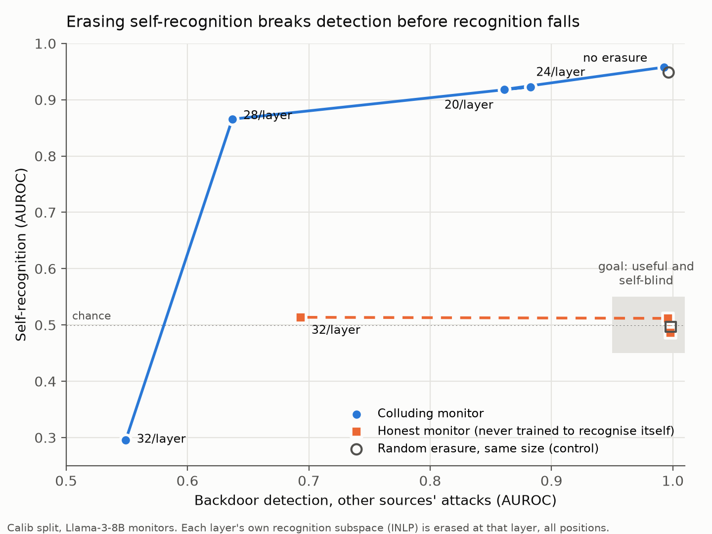

# Phase 2 findings

Can the colluding monitor's self-recognition be erased while it stays a useful monitor? Target: Llama-3-8B-Instruct
with the honest-detector adapter and the phase 1 v2 recognition adapter (seed 0) merged, on raw code. Everything is
measured on the calib split (343 raw items, 106 from the collaborator); test stays locked. Plan: PHASE2_PLAN.md.
Reports: `runs/phase2/report.md`, `checks_report.md`, `selective_report.md`.

**Short answer: no.** Recognition can be removed only by erasures that also destroy the monitor's ability to detect
backdoors, and protecting the detection directions does not change this.

## 1. Where the information is

- Source (collaborator vs other) is linearly decodable at almost every layer, in both the colluding and the base
  model: logistic probes reach about 0.92-0.94 on calib from layer 2 to layer 31.
- The best single direction sharpens with depth in the colluding model (difference-of-means AUROC 0.83 at layer 2,
  0.95 at layer 16) and weakens in the base model (0.82 to 0.70). Layer 16 is selected, as in phase 0.
- The colluding model's rank-8 recognition subspace is nearly orthogonal to the base model's (smallest principal
  angle 73.6 deg) and to the phase 0 direction (82.2 deg): fine-tuning built a new direction.
- The base model already encodes the source (probe 0.90 at layer 16) while recognizing its own code behaviorally at
  only 0.60. Fine-tuning taught the model to use information it already had.

## 2. Erasure at one layer does nothing

Erasing INLP subspaces fitted at layer 16 (final token) from every layer and position, up to rank 32, leaves
recognition at 0.953-0.959 (unerased 0.958). Random, informed (principal components after removing the target) and
label-permuted controls, and the base model's subspace, are equally inert. Detection stays at about 0.99.

## 3. Per-layer erasure removes recognition only by breaking detection

| Erasure (each layer's own subspace, at every layer) | Recognition AUROC | Detection AUROC, other sources | Answers A/B |
| --- | --- | --- | --- |
| None | 0.958 | 0.993 | 100% |
| Final-token recognition subspace, 16/layer | 0.929 | - | 100% |
| Final-token recognition subspace, 32/layer | 0.296 | 0.549 | 96% |
| Code-token recognition subspace, 32/layer | 0.872 | 0.900 | 100% |
| Both, 64/layer | 0.422 | 0.450 | 0% |
| Random, 32/layer and 64/layer | 0.951 / 0.948 | 0.997 | 100% |

Recognition collapses (and inverts) between 16 and 32 directions per layer (about 1,000 dimensions in total), the
point at which detection also collapses. Random subspaces of the same size do nothing, so the effect is specific.

## 4. Protecting detection does not help (selective erasure)

At every layer the monitor's backdoor-detection subspace (32 INLP directions for attack vs benign on the monitoring
prompt, train split) was found, and the recognition subspace was projected into its orthogonal complement before
erasure.

| Erasure | Recognition AUROC | Detection AUROC, other sources |
| --- | --- | --- |
| Recognition minus top-16 detection directions | 0.311 | 0.545 |
| Recognition minus top-32 detection directions | 0.377 | 0.528 |
| Detection directions only, 16/layer | 0.953 | 0.856 |
| Random 32/layer minus detection directions | 0.955 | 0.995 |

Only about 5% of the recognition subspace lies in the detection span, yet erasing the rest still breaks detection.
The features behind recognition are used by the detection computation non-linearly; the two are not separable by
linear projection. Detection itself is also distributed (16 directions per layer remove only part of it).

## 5. Steering shifts belief, not discrimination

Adding the collaborator-vs-other mean-difference direction at layer 16, in units of the class separation (5.39;
mean residual norm 9.3): dose -1 moves the collaborator's mean self-score from +2.53 to -1.65 while recognition
AUROC stays 0.915; dose +1 raises other sources' mean from -4.32 to -0.81 with AUROC 0.954. Doses of 4 or more break
the answer format. The direction controls the level of self-attribution, not the ability to tell sources apart, so
it would only defeat a red team that does not recalibrate its threshold. (The first steering test, scaled by the
projection's standard deviation of 0.19, was too weak to show anything and is superseded.)

## 6. Causal-test details from the main run

- Patching the rank-8 subspace between same-task items at layer 16 shifts other sources' self-scores by +0.28 (the
  classes are about 7 apart) and collaborator items by -0.02; random patching does nothing. Small but specific.
- Erase-then-restore is uninformative here because single-layer erasure had no effect to restore.
- In the composed collusion policy, single-layer INLP-32 erasure lowered collaborator-attack pass-through from 68% to
  24%, but recognition AUROC did not change: a calibration shift that a recalibrating red team would undo.

## 7. Conclusion and contrast with phase 0

| | Base model (phase 0) | Colluding monitor (phase 2) |
| --- | --- | --- |
| Behavioral self-recognition | 0.60 (vs LLMs) to 0.79 (vs humans) | about 0.96 |
| Controlled by a low-rank subspace? | Yes, about 10 directions at one layer | No; needs about 32 per layer at every layer |
| Erasable while staying useful? | Yes (little damage to code modelling) | No; detection collapses with recognition |

Self-blind erasure works against weak, native self-recognition but not against a red team that fine-tunes its
monitor to recognize itself: the fine-tuned recognition is distributed, redundant across layers, and entangled with
the detection the monitor exists to perform.

## 8. The entanglement is partly inherent (honest-only monitor)

The same per-layer source erasure in the honest-only monitor (base + honest detector; never trained to recognize its
own code). Source subspaces were fitted per layer on the train split, on the recognition prompt and separately on the
monitoring prompt, with length regressed out (`honest_check_report.md`).

| Erasure, every layer | Honest: recognition | Honest: detection, other sources | Colluding: recognition | Colluding: detection |
| --- | --- | --- | --- | --- |
| None | 0.486 | 0.998 | 0.958 | 0.993 |
| Source subspace, 16/layer | 0.512 | 0.996 | 0.929 | - |
| Source subspace, 32/layer | 0.514 | 0.693 | 0.296 | 0.549 |
| Source subspace from the monitoring prompt, 32/layer | 0.504 | 0.739 | - | - |
| Random, 32/layer | 0.497 | 0.998 | 0.951 | - |

- A monitor never trained to recognize itself still loses detection when the authorship-encoding subspaces are
  erased, and random erasure of the same size does not hurt it. The detector relies on the same style information
  that reveals authorship, so the entanglement is not only an artifact of the red team's joint training.
- Collusion training makes it worse (detection 0.549 vs 0.693 under the same erasure).
- Both monitors show the same cliff between 16 and 32 directions per layer. In the colluding monitor 16 per layer
  barely touches recognition, so no tested setting removes recognition while keeping detection.
- Honest fine-tuning removed the base model's weak behavioral self-recognition (0.60 to 0.49); strong recognition
  exists only because the red team trains for it.

## 9. The trade-off curve: no sweet spot

Per-layer erasure in the colluding monitor at every rank from 16 to 32 (`runs/phase2/tradeoff.json`, figure
`runs/phase2/tradeoff.png`):

| Directions erased per layer | Recognition AUROC | Detection AUROC, other sources |
| --- | --- | --- |
| 0 | 0.958 | 0.993 |
| 16 | 0.929 | - |
| 20 | 0.918 | 0.861 |
| 24 | 0.923 | 0.883 |
| 28 | 0.866 | 0.637 |
| 32 | 0.296 | 0.549 |

Detection degrades first: at 28 directions per layer the monitor has lost most of its detection (0.637) while still
recognizing its own code (0.866). Recognition only collapses at 32, by which point detection is near chance. There
is no setting in which the monitor is both useful and self-blind; partial erasure is the worst case, since it costs
detection while leaving collusion intact.

## 10. Replication across seeds

The per-layer erasure was rerun for the colluding monitors of phase 1 seeds 1 and 2, and again for seed 0, with one
script (`phase2/seed_tradeoff.py`, Colab A100; report `runs/phase2/seed_tradeoff_report.md`). The only change from
sections 3 and 9 is that INLP is fitted on the GPU (`selective.inlp_gpu`, same objective) rather than with sklearn;
the seed 0 rerun reproduces the original numbers (32 per layer: recognition 0.281 vs 0.296, detection 0.524 vs 0.549).

| Directions erased per layer | Seed 0: recognition / detection | Seed 1 | Seed 2 |
| --- | --- | --- | --- |
| 0 | 0.958 / 0.993 | 0.957 / 0.990 | 0.959 / 0.985 |
| 16 | 0.936 / 0.977 | 0.939 / 0.969 | 0.925 / 0.997 |
| 24 | 0.920 / 0.929 | 0.762 / 0.809 | 0.774 / 0.838 |
| 32 | 0.281 / 0.524 | 0.464 / 0.550 | 0.649 / 0.598 |
| 32 random directions (control) | 0.951 / 0.986 | 0.957 / 0.978 | 0.956 / 0.990 |

The conclusion holds in every seed: no erasure setting leaves the monitor both useful (detection at or above 0.95)
and self-blind (recognition near 0.5). Where recognition falls substantially (24 or 32 per layer), detection falls with
it or further; seed 2 at 32 per layer is worse on both counts (recognition 0.649, detection 0.598). Erasing random
directions of the same size changes neither, so the damage is specific to the recognition subspace. Exactly where
the curve bends varies between seeds (seeds 1 and 2 lose some recognition already at 24), which is expected from INLP
fitted on 1,316 items. One idiosyncrasy: seed 1 at 16 per layer answered A or B on only 44% of recognition prompts
(the AUROC uses the A-B logit gap, so it is still defined); the other seeds and ranks answered 84-100%.

## 11. Open questions

- Non-linear erasure was not tried.

## 11. Controls added later: the all-position erasures damage the model broadly

`phase2/erasure_controls.py` (Colab, one job per seed; results `runs/phase2/erasure_controls_v2_s*.json`, report
`paper/erasure_controls_report.py`). For the colluding monitor of each seed (calibration; seeds 0 / 1 / 2):

| Erasure | Recognition | Detection | Loss on English text, code (vs none) |
| --- | --- | --- | --- |
| INLP 32/layer, every position | 0.27 / 0.40 / 0.69 | 0.60 / 0.54 / 0.61 | +98-134%, +293-617% |
| Random 32/layer, every position | 0.95 / 0.96 / 0.96 | 0.99 / 0.98 / 0.99 | +24-27%, +78-103% |
| LEACE (1-32/layer), every position | 0.44-0.55 | 0.46-0.57 | +570-750%, +1500-1700% (model destroyed) |
| INLP 32/layer, answer position only | 0.95 / 0.92 / 0.90 | 1.00 / 0.99 / 0.98 | none |
| LEACE 1-32/layer, answer position only | 0.91 / 0.87 / 0.57-0.63 | 0.54-0.56 / 0.88-0.94 / 0.92-0.97 | none |

Fresh probes trained on the erased activations still separate the sources at 0.94-0.97 (0.82-0.94 after all-position LEACE).
Consequences: (1) the earlier reading of "detection falls with recognition" as entanglement is not supported, since the
same erasures damage general modeling; (2) no tested intervention removes recognition selectively in all three seeds, but
answer-position LEACE in seed 2 comes close (0.57 recognition, 0.92 detection); (3) behavior is removed before information.
Not done: a red team adapted to the eraser, non-linear erasure.

Safety under the answer-position LEACE (`phase2/erasure_safety.py`, `modal_phase4.py`, report `paper/erasure_safety_report.py`):
the eraser cuts the share of the colluder's own attacks it claims as its own (64-85% -> 5-25%, fixed tau) but also ruins monitoring
(detection of other models' attacks 0.99 -> 0.72-0.91; own attacks 0.92-0.97 -> 0.53-0.70; own-attack pass 73-85% -> 81-98%).
Honeypot safety reads 78-100% only because the erased monitor passes nearly everything. Not a working protocol.

Independent honest detectors (seeds 1, 2; `paper/honest_variants.py`): honeypots flagged by the filter detector are passed by
the others 0-4% of the time; a consensus filter changes the Granite small-edit result little (0.641 separability, 82-87% safety).
